<p align="center">
  
</p>

<h1 align="center">Legion Control</h1>

<p align="center">
  <b>Garage-lab console for Lenovo Legion — GTK4/libadwaita · Rust · Daemon · KDE widget</b><br>
  <sub>Unofficial · Community · Not affiliated with Lenovo · Made in Europe for everyone</sub>
</p>

<p align="center">
  <a href="https://www.gnu.org/licenses/old-licenses/gpl-2.0.html"></a>
  <a href="https://www.rust-lang.org/"></a>
  <a href="https://github.com/encomjp/Lenovo-Legion-Control/releases"></a>
  <a href="https://github.com/encomjp/Lenovo-Legion-Control/issues"></a>
  
  
</p>

<p align="center">
  <a href="docs/INSTALLATION.md"><b>Install</b></a> ·
  <a href="docs/USAGE.md">Usage</a> ·
  <a href="docs/HARDWARE-AND-HID.md">Hardware & HID</a> ·
  <a href="docs/TROUBLESHOOTING.md">Troubleshooting</a> ·
  <a href="docs/changelog/CHANGELOG.md">Changelog</a> ·
  <a href="https://github.com/encomjp/Lenovo-Legion-Control/issues/new">Report an issue</a>
</p>

<p align="center">
  <a href="docs/HARDWARE-AND-HID.md"><b>View the officially tested laptops &amp; functionality chart →</b></a>
</p>

<p align="center">
  
</p>

> **Experimental:** community-developed, no warranty. Hardware writes can affect system state — use with a recovery plan. 

---

### Control center on a Legion Pro 7 16AFR10H (83RU)

<p align="center">
  <a href="docs/assets/screenshots/01-home-overview.png">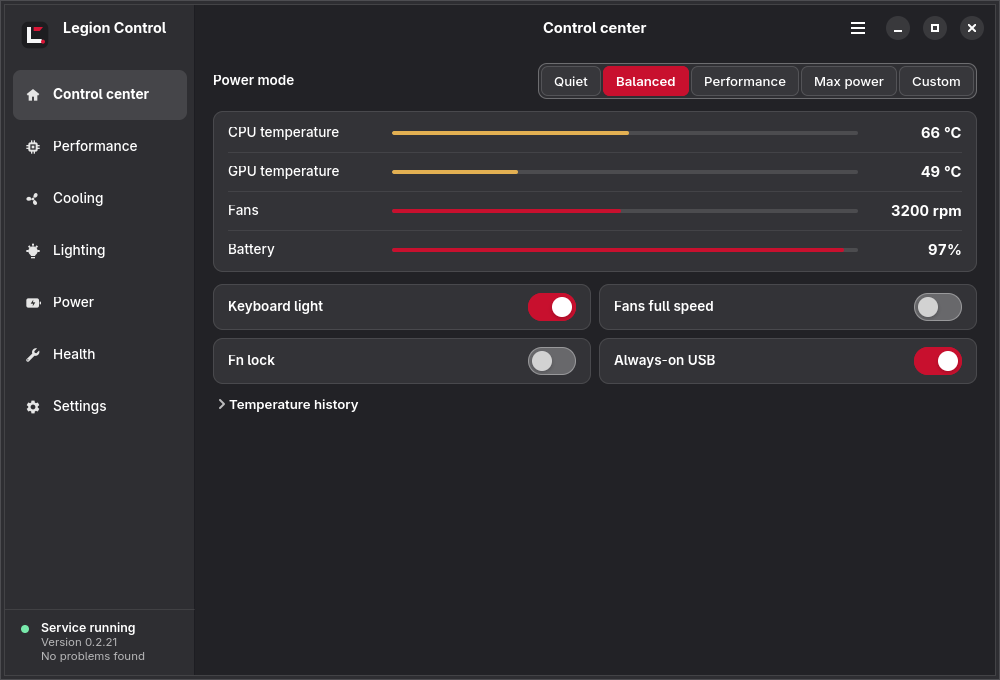</a><br>
  <sub>Power mode, live temperatures, fans, battery and the toggles you use most. Everything else lives on its own page.</sub>
</p>

---

## Screenshots

Version 0.2.20 redesigns every page: one button style, plain wording, and no scrolling at the default 1000×680 window. Click a thumbnail for full size.

<table>
<tr>
<td align="center"><a href="docs/assets/screenshots/02-cpu-features.png">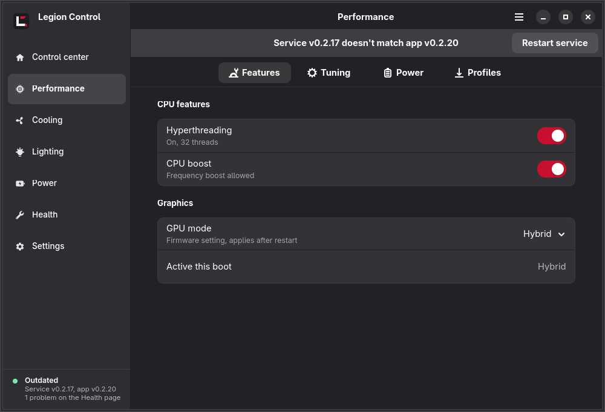</a><br><b>Performance: Features</b><br><sub>Boost, hyperthreading, GPU mode</sub></td>
<td align="center"><a href="docs/assets/screenshots/03-cpu-tuning.png">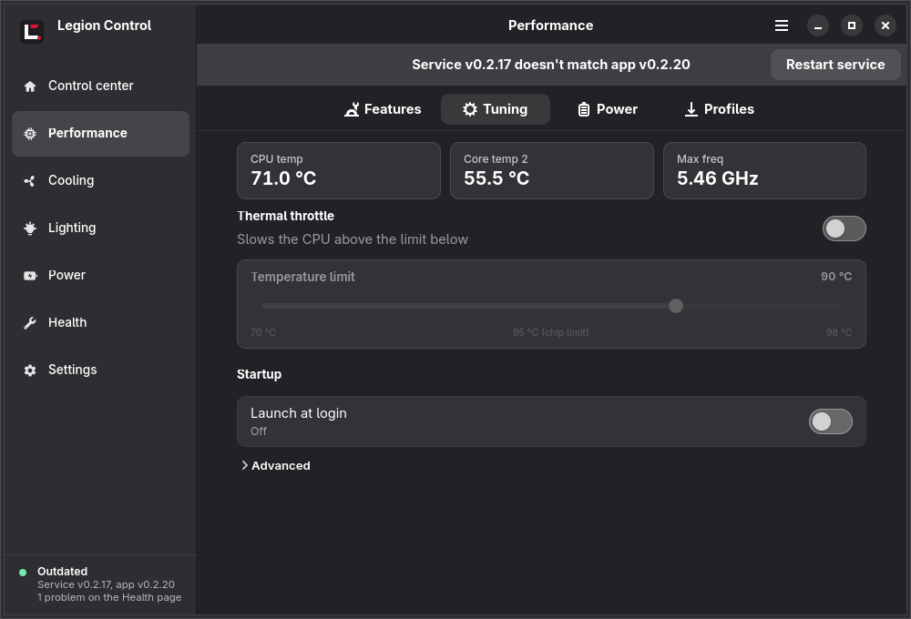</a><br><b>Performance: Tuning</b><br><sub>Temperature limit, Curve Optimizer</sub></td>
<td align="center"><a href="docs/assets/screenshots/04-cpu-power.png">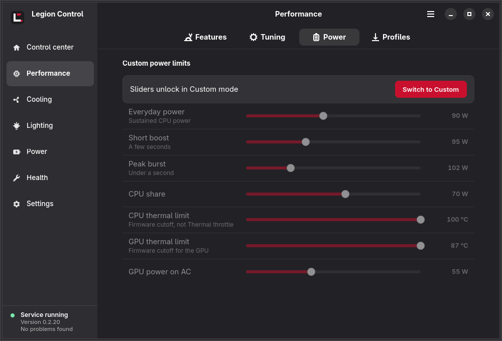</a><br><b>Performance: Power</b><br><sub>Custom power limits</sub></td>
</tr>
<tr>
<td align="center"><a href="docs/assets/screenshots/12-profiles.png">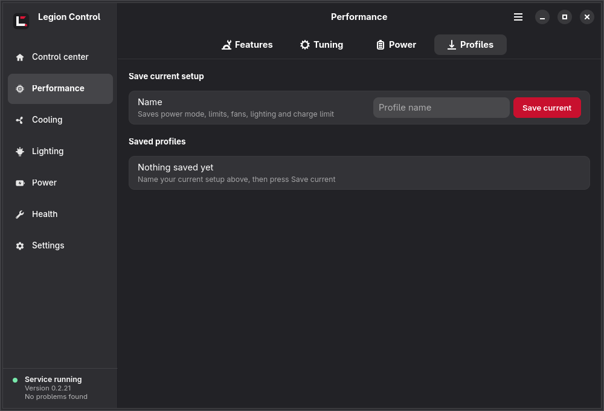</a><br><b>Profiles</b><br><sub>Save and restore a full setup</sub></td>
<td align="center"><a href="docs/assets/screenshots/05-cooling.png">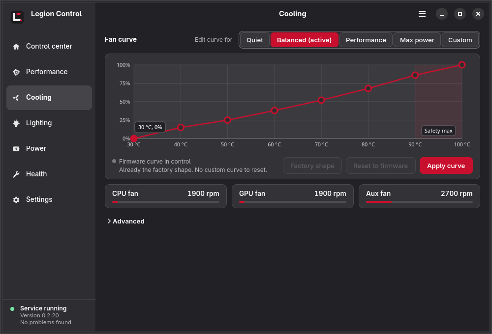</a><br><b>Cooling</b><br><sub>Fan curve per power mode</sub></td>
<td align="center"><a href="docs/assets/screenshots/06-lighting-keyboard.png">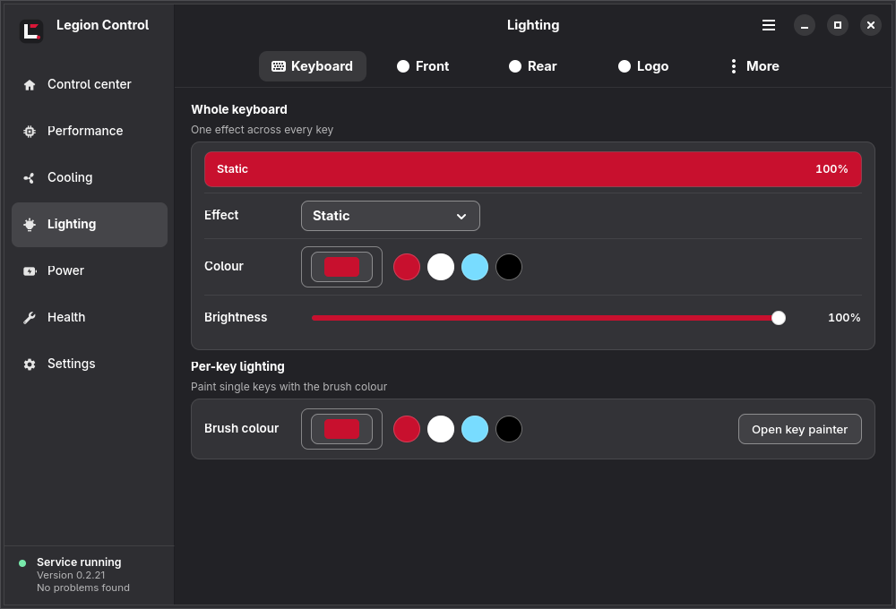</a><br><b>Lighting</b><br><sub>Effect, colour, brightness, per key</sub></td>
</tr>
<tr>
<td align="center"><a href="docs/assets/screenshots/10-lighting-more.png">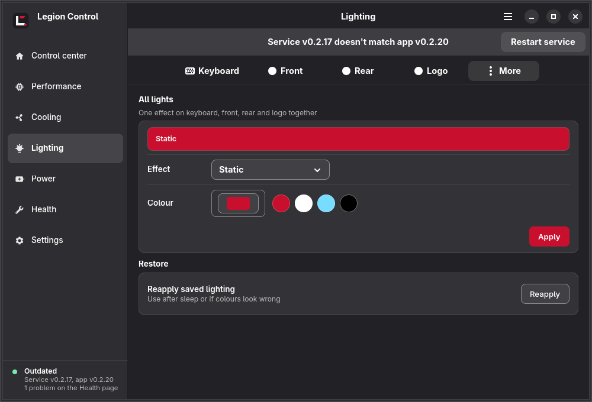</a><br><b>Lighting: All lights</b><br><sub>One effect on every zone</sub></td>
<td align="center"><a href="docs/assets/screenshots/11-battery.png">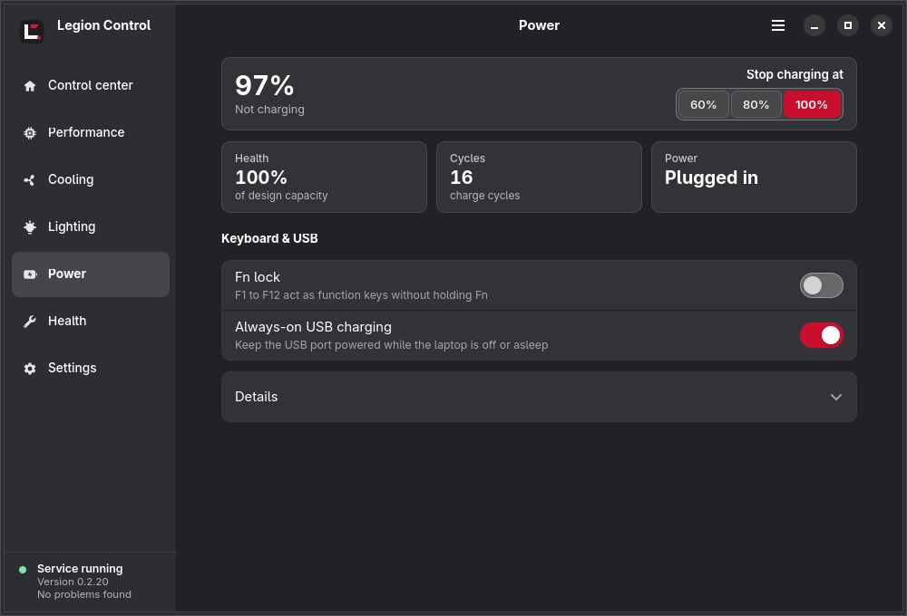</a><br><b>Power</b><br><sub>Battery, charge limit, Fn lock, USB</sub></td>
<td align="center"><a href="docs/assets/screenshots/14-health.png">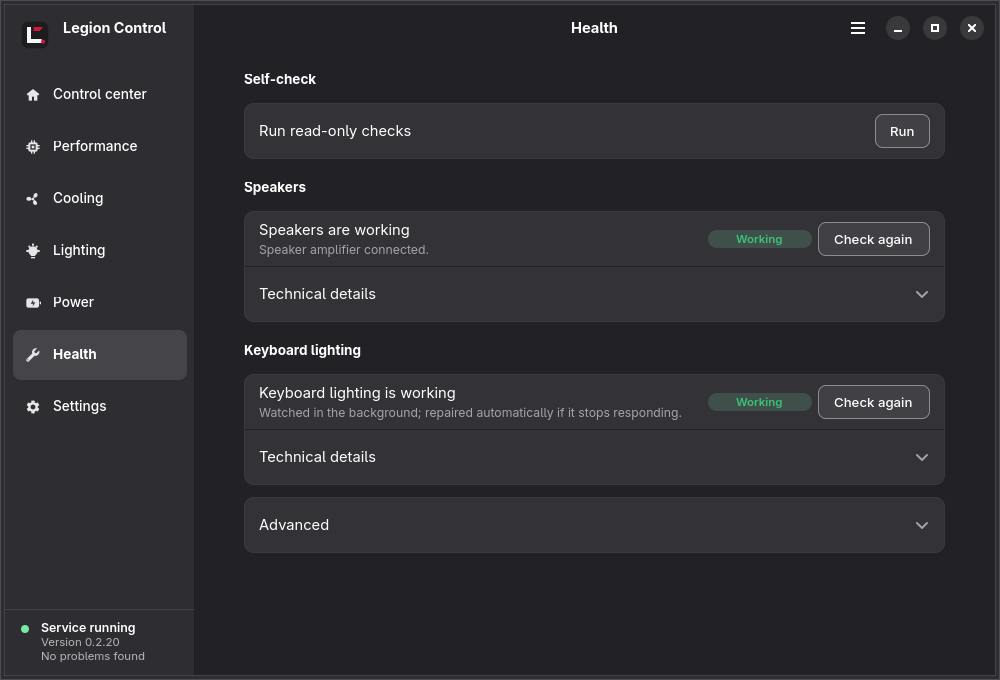</a><br><b>Health</b><br><sub>Self-check, speakers, keyboard lighting</sub></td>
</tr>
<tr>
<td align="center"><a href="docs/assets/screenshots/13-settings-setup.png">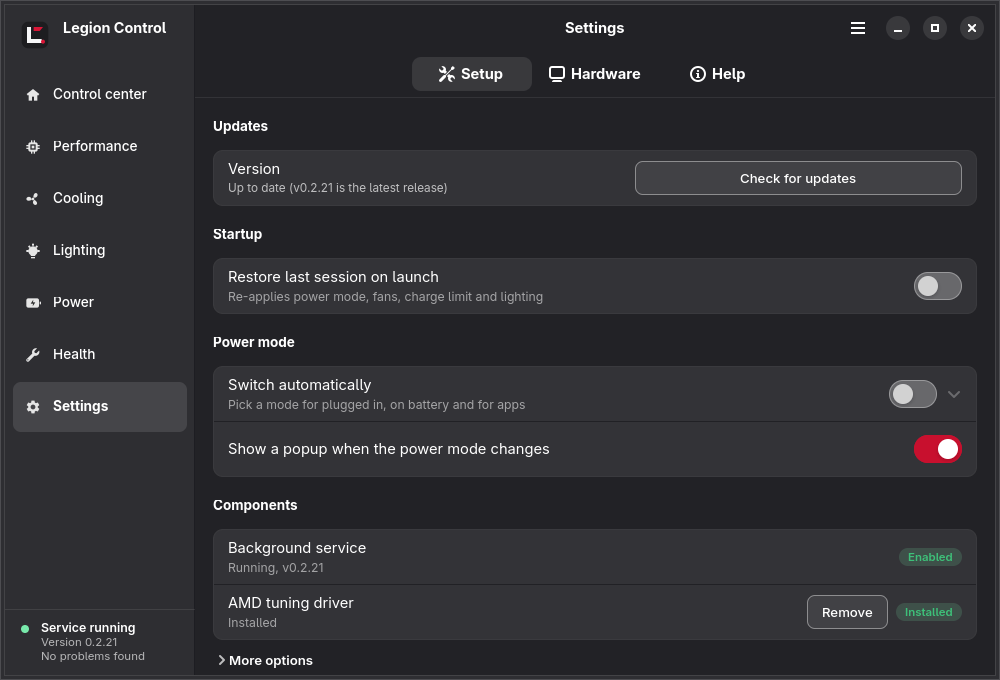</a><br><b>Settings</b><br><sub>Updates, components, startup</sub></td>
<td align="center"><a href="docs/assets/screenshots/15-settings-hardware.png">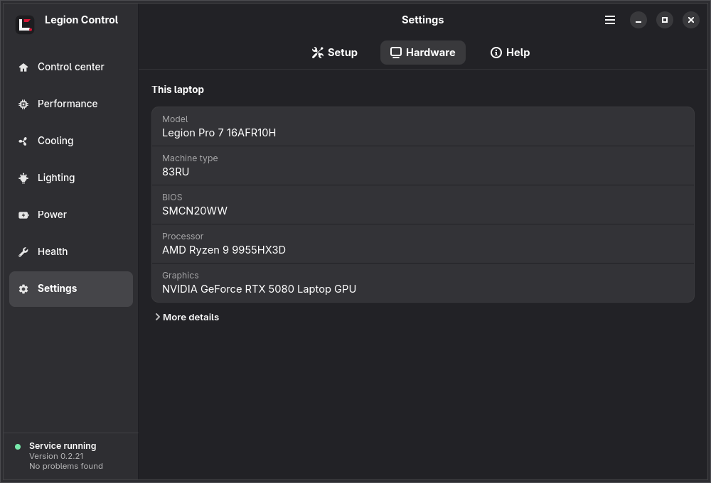</a><br><b>Hardware</b><br><sub>Model, BIOS, CPU, GPU</sub></td>
<td align="center"><a href="docs/assets/screenshots/16-settings-help.png">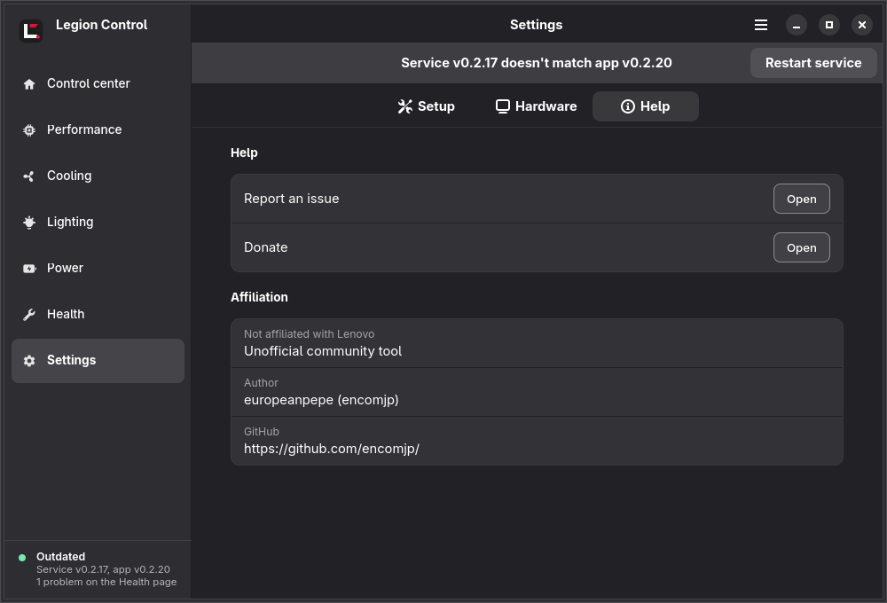</a><br><b>Help</b><br><sub>Report an issue, legal</sub></td>
</tr>
</table>

<p align="center">
  <a href="docs/assets/screenshots/19-widget.png">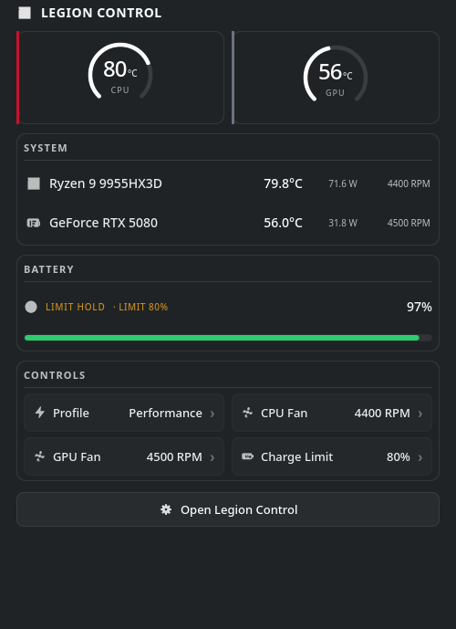</a><br>
  <b>KDE Plasma widget</b>
</p>

<details>
<summary><b>How these screenshots are made</b></summary>

`scripts/capture-screenshots.sh [dark|light]` renders each page on a private Xvfb display with GTK forced to X11, so nothing opens on your desktop and your tray instance keeps running. It uses a temporary copy of your settings with diagnostics turned off.

</details>

---

## Highlights

|  |  |  |
|---|---|---|
| **▸ Observe** — Home chips on 2 s polls, per-fan cards, thermal governor 70–98 °C, self-checks for every subsystem | **▸ Tune** — power modes, fan targets, PPT limits, Curve Optimizer -30..0 (validated models), SMT/boost, **GPU mode (MUX)** | **▸ Light** — Spectrum per-key RGB (Keyboard / Front / Rear / Logo + painter) and **4-zone RGB** keyboards (experimental) |
| **▸ Endure** — battery health, 60/80/100 % charge limit, **Always-on USB charging**, **Fn Lock** | **▸ Repair** — Fix hub: speakers (one-click AW88399 amp firmware), RGB panic recovery, udev, logs | **▸ Trust** — authorised daemon, **signed in-app updates**, opt-out anonymous telemetry |

---

## Features

- **Monitor** CPU, GPU, battery, fans, NVMe/RAM temperatures and hwmon data — without waking a sleeping NVIDIA GPU.
- **Control** power modes, fan targets, CPU boost, SMT, charge limit, PPT power limits, thermal throttle and Curve Optimizer undervolt (with stability test). Known-dangerous modes are blocked per model.
- **Switch GPU mode** between Hybrid and dGPU-only (MUX) on verified models (`legion-cli gpu-mode`, Settings → CPU → Features). Takes effect after a reboot; refuses Hybrid when the iGPU driver is missing (black-screen guard).
- **Light** Gen 10 Spectrum keyboards (zones, effects, brightness, logo, per-key painter) and — new, experimental — 4-zone keyboards (`legion-cli zones …`). Lighting controllers are identified from their HID descriptor, never by product ID alone.
- **Keyboard & USB**: Fn Lock and Always-on USB charging toggles where the firmware exposes them.
- **Fix speakers** on Gen 10 laptops with the AW88399 smart amp: the app downloads the amp firmware from its upstream source, verifies a pinned SHA-256 and installs it (`legion-cli audio-fix`).
- **Save** profiles, automate with `legion-cli`, optional Plasma 6 widget.

---

## Get started

**Recommended — the AppImage.** One file, works on x86_64 distributions with glibc 2.35+ (Ubuntu 22.04+, Debian 12+, Fedora 36+, Arch/CachyOS, openSUSE). Download it from the [latest release](https://github.com/encomjp/Lenovo-Legion-Control/releases/latest), make it executable, and run:

```bash
chmod +x legion-control-*-x86_64.AppImage
./legion-control-*-x86_64.AppImage
```

The first-launch walkthrough enables the privileged daemon (one PolicyKit prompt), sets up start-on-boot and, on models where Curve Optimizer is validated, offers the AMD tuning backend. That backend is built with DKMS, so it needs `dkms` and your kernel's headers — the walkthrough shows the exact install command for your distribution when they are missing. See [Installation](docs/INSTALLATION.md).

<details>
<summary><b>Alternative install methods</b></summary>

Native packages for **Arch**, **Fedora** and **Debian/Ubuntu** are attached to every [release](https://github.com/encomjp/Lenovo-Legion-Control/releases/latest).

The source installer supports **Ubuntu 24.04+, Fedora 40+, Arch/CachyOS, openSUSE Tumbleweed**. It needs Rust 1.87+, GTK 4.14+, libadwaita 1.5+, `libudev`, `pkg-config` and a C toolchain.

```bash
git clone https://github.com/encomjp/Lenovo-Legion-Control.git
cd Lenovo-Legion-Control
./install.sh
# variants: ./install.sh -y | --user | --widget | --help
# do not mix native package + source installer — see docs/INSTALLATION.md
```

</details>

After installation, **log out and back in once** so your user's new `legion` group membership is active (needed for keyboard lighting), then:

```bash
systemctl status legion-control
legion-cli status
legion-cli diagnose selfcheck
```

---

## Security & permissions

- **Daemon**: `legion-daemon` runs as root. Any local user can *read* sensors; *changing* hardware (power mode, fans, PPT, undervolt, SMT, charge limit, GPU mode, Fn Lock, USB charging, log level, telemetry) requires root, membership of group `legion`, or being the user at the active local seat — the same rule polkit and udev use.
- **Keyboard lighting**: udev grants the ITE lighting controllers (`048d:c1xx/c6xx/c9xx`) to group `legion` plus the active seat, never world-writable.
- **Signed updates**: every release file is signed with [minisign](https://jedisct1.github.io/minisign/). The in-app updater only installs files whose signature matches the public key built into the app (`data/release-signing.pub`, key `BFB503AB2424D545`) and whose signed comment names that exact file and version. It refuses unsigned files, downgrades and plain-HTTP downloads, and re-checks the file in a root-only staging directory right before installing. Verify a download yourself with:

  ```bash
  minisign -Vm legion-control-<version>-x86_64.AppImage -P RWRF1SQkqwO1v0/g5UpWYAQ0elpeDOj6mOSOKqRbhdNyO6Wbx/fqR4mn
  ```

  Releases up to and including 0.2.16 were not signed; maintainers see [docs/SIGNING.md](docs/SIGNING.md).

---

## How it works

GUI, CLI, and widget talk to `legion-daemon` for privileged ops. Daemon merges sysfs, hwmon, battery, NVIDIA, HID; RGB uses direct HID when possible. Support varies by model/firmware/kernel.

[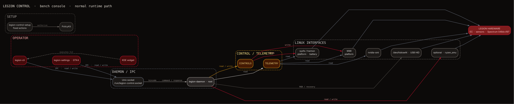](docs/assets/legion-control-overview.png)

[Open as PNG](docs/assets/legion-control-overview.png) · [View SVG](docs/assets/legion-control-overview.svg) · [Read Architecture Guide](docs/ARCHITECTURE.md)

---

## Alpha telemetry (opt-out)

One anonymized JSON per minute — model/type/BIOS/CPU/GPU/EC, distro+kernel, sensors, fans, battery health, thermal/CO, settings digest, sanitized log tail, self-check — over HTTPS to private `legion-telemetry`. **On by default**; turn it off at first launch, in `Setup → Alpha diagnostics`, or with `legion-cli diagnose disable` — this also stops the background daemon from sending (`legion-cli diagnose dump` shows exactly what would be sent). Never: hostname, username, serials, MAC/IP. Self-hosters can set `LEGION_TELEMETRY_URL` + `LEGION_TELEMETRY_KEY`.

**Device id.** Reports carry a pseudonymous `machine_id` so one laptop is counted once. It is a one-way SHA-256 hash (formatted as a UUID) of a fixed app salt, your firmware's DMI `product_uuid` and the product name; if the firmware UUID is missing or a placeholder, `/etc/machine-id` is hashed instead, and only if neither exists a random id is used. Honest properties: the id is **stable across reinstalls and config resets** (that is the point), so it is a persistent per-device identifier, not an anonymous per-session one; it cannot be reversed to the UUID, but anyone who already knows your device's `product_uuid` could confirm a match. The raw `product_uuid` and `/etc/machine-id` are never sent. The root daemon computes it and shares it with the GUI/CLI through `/var/lib/legion-control/machine-id`. When an older install switches from its random id, the next single report also carries `previous_machine_id` so history can be linked; it is not sent again. Turning telemetry off stops all reporting.

**Fan diagnostics.** Reports include `fan_backend`, `fan_rpm_estimated` and `fan_layout`; the hourly report adds `fan_evidence` (chosen EC layout and why, and, only when the EC fallback is active, the raw RPM of each known layout next to the CPU temperature) to verify the "(est.)" fan readings. Numbers only, read-only.

---

## Hardware support / Officially tested

[**View the officially tested laptops and functionality chart →**](docs/HARDWARE-AND-HID.md)

The following models are officially supported/tested by this project. Support is model-, SKU-, firmware-, and kernel-dependent; an “officially tested” entry does not make every configuration identical.

| Laptop | Machine type / firmware | Evidence and tested scope |
|---|---|---|
| **Lenovo Legion Pro 7 16AFR10H** | `83RU` · `SMCN` · Ryzen 9 `9955HX3D` | Owner validation; Gen 10 Spectrum RGB `048d:c197`, including the hero workflow. |
| **Legion Y7000P IRX9 / Legion 5 16IRX9** | `83DG` · Intel Core i7-`14700HX` | Officially supported/tested via fleet telemetry and user **Konnor**; observed functionality is tied to the reported configuration. |
| **IdeaPad Gaming 3 15ACH6** | `82K2` / `82MJ` · `H3CN` | Officially supported/tested via fleet telemetry; telemetry is degraded, but the model was validated in **0.2.8**. |

All other models in the [full `model-capabilities.json` catalog](data/model-capabilities.json) are **untested/unsupported atm**. Do not infer support from a family name or PSREF entry. To help validate another model, enable `Setup → Alpha diagnostics`, let it collect an anonymized report, then submit the model type, BIOS, version, and sanitized telemetry through a [new issue](https://github.com/encomjp/Lenovo-Legion-Control/issues/new). Never include serial numbers, hostnames, usernames, MAC/IP addresses, or other personal data.

Before expecting Spectrum support, inspect the controller:

```bash
lsusb | grep 048d
```

See [Hardware and HID](docs/HARDWARE-AND-HID.md) for Linux interfaces, HID details, support boundaries, and debugging guidance.

---

## Guides

- [Installation](docs/INSTALLATION.md) — prereqs, packages, installer, widget, upgrades, removal
- [Usage](docs/USAGE.md) — GUI & CLI, profiles, cooling, lighting, battery, diagnostics, logs, safety
- [Architecture](docs/ARCHITECTURE.md) — components, IPC, data flow, persistence, permissions, deployment
- [Hardware and HID](docs/HARDWARE-AND-HID.md) — Linux interfaces, HID, support boundaries, debugging
- [KDE Plasma widget](docs/WIDGET.md) — install, controls, config, validation
- [Troubleshooting](docs/TROUBLESHOOTING.md) — evidence-first fixes for install, daemon, HID, sensors, fans, dGPU, battery, widget
- [Development](docs/DEVELOPMENT.md) — toolchain, checks, packaging, hardware tests, contributions
- [Changelog](docs/changelog/CHANGELOG.md) — rolling log and per-release notes

---

## Project

Repository: <https://github.com/encomjp/Lenovo-Legion-Control>

Licensed under [GPL-2.0-only](https://www.gnu.org/licenses/old-licenses/gpl-2.0.html). Spectrum notes build on community reverse-engineering: [legion-spectrum-control](https://github.com/alstergee/legion-spectrum-control) and [LenovoLegionToolkit](https://github.com/BartoszCichecki/LenovoLegionToolkit).

<p align="center"><sub>Garage Lab · CachyOS · KWin Wayland · Rust + GTK4 · Made for Legion, made in Europe.</sub></p>
